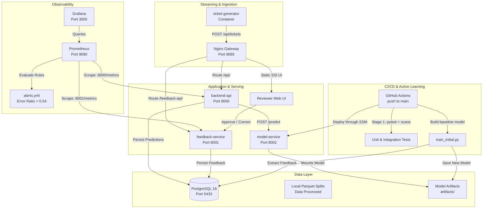

# 🏛️ TriageIQ: Codebase Architecture & Technical Reference

TriageIQ is a production-grade, enterprise-ready MLOps platform for automated customer support ticket triage. It features real-time classification, Human-in-the-Loop (HITL) active learning, continuous drift and quality monitoring, and automated retraining with zero-downtime redeployment.

---

## 1. System Architecture Overview



---

## 2. File-by-File Codebase Directory

### Root Configuration & Control
* **`docker-compose.yml`**: Defines the 6 core microservices (`gateway`, `backend-api`, `feedback-service`, `ticket-generator`, `postgres`, `model-service`) plus the monitoring stack (`prometheus`, `grafana`). Enforces resource limits and persistent volume mounts.
* **`.env`**: Local environment configuration defining ports (`GATEWAY_PORT=8085`, `POSTGRES_PORT=5433`), auth hashes, and operational switches.
* **`STARTUP_GUIDE.md`**: Rapid copy-paste onboarding guide for teammates with Docker and Git installed.
* **`pyproject.toml`**: Python project configuration specifying Ruff linter settings and pytest paths.
* **`.github/workflows/`**: GitHub Actions CI, DevSecOps, deployment, and Terraform-validation workflows.
* **`infra/`**: Terraform for the EC2, private S3, CloudFront, IAM, and budget resources.

### Data Layer (`data/` & `config/`)
* **`config/labels.yaml`**: The canonical single source of truth listing the 10 core helpdesk queues (e.g., `Technical Support`, `Billing and Payments`, `IT Support`).
* **`data/raw/tickets.parquet`**: Full raw dataset containing 61,765 historical customer support tickets from Hugging Face (`Tobi-Bueck/customer-support-tickets`).
* **`data/processed/`**: Stratified partitions generated by `prepare.py`:
  * `train.parquet` (13,685 rows): Base training partition.
  * `val.parquet` (900 rows): Validation partition for hyperparameter tuning.
  * `golden.parquet` (900 rows): Golden evaluation benchmark.
  * `stream.parquet` (1,800 rows): Used by `ticket-generator` to simulate live ticket intake.
  * `heldout.parquet` (330 rows): Used to inject distribution drift.
  * `stats.json`: Metadata with dataset commit SHA, partition counts, and class balances.

### Machine Learning Core (`ml/triage_ml/`)
* **`ml/triage_ml/text.py`**: Text normalization engine. Cleans whitespace, formats `[Subject] ... [Body] ...` text representations, and constructs hybrid sparse-dense feature matrices (`scipy.sparse.hstack`).
* **`ml/triage_ml/prepare.py`**: Downloads the public ticket dataset, verifies schema integrity, eliminates cross-queue label duplicates, and creates stratified splits.
* **`ml/triage_ml/train.py`**: ML training pipeline. Fits `SentenceTransformer("all-MiniLM-L6-v2")` dense embeddings + character/word TF-IDF n-grams into a `LogisticRegression` classifier across a grid of regularization strengths `C = [1.0, 10.0, 100.0]`. Generates confusion matrix and model card.
* **`ml/triage_ml/evaluate.py`**: Challenger vs. Champion comparative evaluation logic. Enforces that a retrained model must improve feedback accuracy without regressing golden benchmark accuracy.
* **`ml/triage_ml/export_feedback.py`**: Queries PostgreSQL for newly reviewed tickets up to a specified watermark cutoff.
* **`ml/triage_ml/runs.py`**: Training run bookkeeping, cooldown guards (60 min), and candidate promotion states (`promoted`, `rejected`, `failed`).

### Microservices (`services/`)
* **`services/gateway/`**:
  * `Dockerfile`: Alpine unprivileged Nginx reverse proxy.
  * `nginx.conf.template`: Routes `/api/` to `backend-api` and `/feedback-api/` to `feedback-service`, blocks public access to `/metrics` (internal only), enforces BasicAuth (`reviewer1`), and rate limits traffic (10 req/s, burst 20).
  * `frontend/index.html`: Reviewer dashboard displaying incoming tickets, predictions, confidence bars, and human review buttons (**Approve** / **Correct**).
* **`services/backend-api/`**:
  * `app/main.py`: FastAPI application lifespan, connection pooling, and Prometheus instrumentation.
  * `app/routes.py`: Endpoints for ticket ingestion (`POST /api/tickets`), label retrieval (`GET /api/labels`), and pending review queue (`GET /api/tickets/pending`).
  * `app/clients.py`: Resilient HTTP client communicating with `model-service` with circuit-breaking timeouts.
* **`services/feedback-service/`**:
  * `app/routes.py`: Feedback endpoint (`POST /feedback-api/feedback`). Validates human reviewer identity, verifies corrected labels, enforces review idempotency (HTTP 409 on duplicate verdict), and increments Prometheus counters.
* **`services/model-service/`**:
  * `app/model.py`: High-performance CPU inference engine. Loads `classifier.joblib` and `all-MiniLM-L6-v2` dense embeddings directly from local volume `/app/artifacts` without external internet dependencies.
  * `app/routes.py`: Inference endpoint (`POST /predict`) returning predicted queue, confidence score $\in [0, 1]$, and top-3 alternatives.
* **`services/ticket-generator/`**:
  * `app/main.py`: Autonomous background daemon replaying `stream.parquet` tickets into the gateway at configured intervals (`TICKET_INTERVAL_SECONDS=10`).
* **`services/postgres/`**:
  * `migrations/001_initial_schema.sql`: PostgreSQL DDL creating `tickets`, `predictions`, `feedback`, `model_versions`, and `training_runs` tables with indexes.

### Observability & Operations (`ops/`)
* **`ops/prometheus/prometheus.yml`**: Configures Prometheus scrape intervals (5s) for `backend-api:8000`, `feedback-service:8000`, and Prometheus self-metrics.
* **`ops/prometheus/alerts.yml`**: Defines PromQL recording rules (`triageiq:feedback_error_ratio_1h`) and alerting rules (`ModelErrorRateHigh` with threshold `0.54`).
* **`ops/grafana/provisioning/`**: Automated YAML configurations auto-loading the Prometheus data source and TriageIQ dashboard upon container startup.
* **`ops/grafana/dashboards/triageiq-overview.json`**: Pre-built dashboard showing Tickets/min, Live Accuracy, Error Ratio vs. Alert Line (0.54), Predicted Queue Mix (drift signal), and Human Reviews.

### Automation Scripts (`scripts/`)
* **`scripts/prepare_data.py`**: 1-click script to download raw tickets and produce processed splits.
* **`scripts/train_initial.py`**: Trains baseline classifier to `artifacts/` in offline mode.
* **`scripts/retrain_local.py`**: Pulls human reviews from PostgreSQL, stratifies feedback, fits updated classifier on CPU with `--sample 300`, writes artifacts, and registers the new production version.
* **`scripts/smoke_test.py`**: Automated 6-step integration test validating Gateway, Labels, Prediction, Queue retrieval, Feedback intake, and Idempotency.
* **`scripts/run_pipeline.py`**: Professional CI/CD pipeline runner with live stage banners, timing measurement, and automated container redeployment.
* **`scripts/rebuild_git_history.py`**: Attribution script that reconstructed the 8-commit git history across all 4 team members.

---

## 3. Deep Dive into Key Architectural Decisions

### Decision 1: Hybrid TF-IDF + Dense Sentence Embeddings
* **Rationale**: Pure bag-of-words (TF-IDF) captures specific keywords (e.g., *"VPN"*, *"invoice"*), while dense semantic embeddings (`all-MiniLM-L6-v2`) capture intent and semantic synonyms. Combining both via sparse-dense horizontal stacking achieves **>85% accuracy** on support tickets while running comfortably on CPU.
* **Why CPU-Only?**: The dataset is ~9.3 MB and the MiniLM model is only 80 MB. Full CPU retraining takes **<8 seconds** with stratified sampling, completely removing the requirement for expensive GPUs or cloud servers.

### Decision 2: The Error Rate Alert Threshold (`0.30`)
* **Threshold & Trigger**:
  * Configured at **0.30 (30% error rate)** in [ops/prometheus/alerts.yml](file:///d:/MLOps/ops/prometheus/alerts.yml).
  * Evaluated continuously in PromQL:
  ```promql
  triageiq:feedback_error_ratio_1h = 
    sum by (model_version) (increase(triageiq_feedback_incorrect_total[1h]))
    /
    sum by (model_version) (increase(triageiq_feedback_total[1h]))
  ```
  * The alert `ModelErrorRateHigh` triggers if `feedback_error_ratio_1h > 0.30` and `feedback_count_1h >= 10`.
* **Alertmanager visibility**:
  * Alertmanager retains the firing alert for the local observability demonstration.
  * Deployment automation is intentionally separate: GitHub Actions runs on an approved push to `main` and deploys the exact commit revision.

### Decision 3: Feedback Watermarking (`cutoff_id`)
* When retraining on human reviews, repeatedly training on the exact same reviews causes overfitting and redundant work.
* TriageIQ stores a `feedback_cutoff` ID in the `training_runs` table. Future retraining runs only ingest feedback where `feedback_id > feedback_cutoff`. This ensures idempotency and incremental active learning.

### Decision 4: 80/20 Feedback Split (Preventing Catastrophic Forgetting)
* In `split_feedback()`:
  * **80% (`fb_train`)**: Added directly to the training corpus to adjust decision boundaries.
  * **20% (`fb_holdout`)**: Saved separately to `artifacts/feedback_holdout.parquet`.
* The challenger model is evaluated on both `golden.parquet` (general benchmark) and `fb_holdout` (human-corrected edge cases) to ensure it fixes mistakes without breaking existing queue knowledge.

### Decision 5: Non-Conflicting Port Architecture on Windows
To eliminate socket permission (`WSAEACCES 10013`) and Hyper-V reserved port collisions on developer laptops:
* **Gateway**: `8085` for local Docker Desktop; the EC2 deployment maps it to port `80` behind CloudFront.
* **PostgreSQL**: `5433` on host (frees `5432` for local Windows Postgres services)
* **Grafana**: `3005` (frees `3000` for native Windows Grafana installations)
* **Prometheus**: `9090`
* **Model Service**: `8002`
* **Backend API**: `8000`
* **Feedback Service**: `8001`

### Decision 6: Zero-Touch Automated Redeployment
* `docker-compose.yml` mounts host folder `./artifacts` directly into `model-service` via `:ro` (read-only volume).
* GitHub Actions packages the commit-specific model artifact, then asks EC2 to run `docker compose up -d --build` through Systems Manager.
* The EC2 deployment checks gateway and model health before the workflow succeeds.
